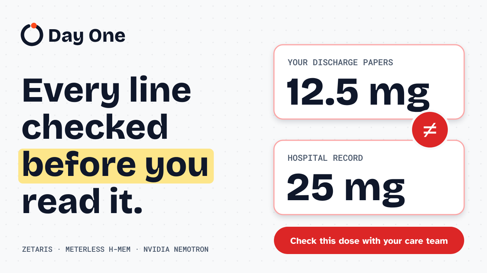
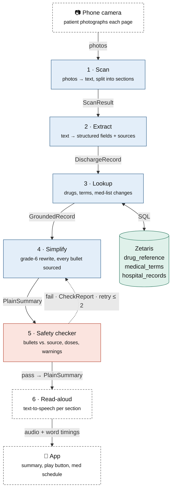

# day-one — Discharge Summary Agent Pipeline

> **Open Agent Hackathon 2026 · Oct 22–27**

A web app (it works on a phone too) where a patient **uploads a photo or the text of their hospital discharge summary** and gets a **plain-language version** they can read or listen to.

Discharge papers are dense with jargon, abbreviations, and dosing instructions that are easy to misread at exactly the moment a patient is tired, stressed, and going home. This project turns those papers into a short, sourced, grade-6 summary with a daily medicine schedule, a clear "call 911 if" list, and read-aloud audio, and it checks itself for safety before anything reaches the patient.

### 🎬 Demo video

[](https://drive.google.com/file/d/1IAq3sDdOzEovv0nM05ztE75TxEXevYIE/view?usp=drive_link)

**[Watch the 1:25 demo on Google Drive](https://drive.google.com/file/d/1IAq3sDdOzEovv0nM05ztE75TxEXevYIE/view?usp=drive_link)**: the agent pipeline, Zetaris lookups, H-MEM catching a carvedilol dose mismatch, and the safety checker. Script: [`docs/demo-video-script.md`](docs/demo-video-script.md).

---

## For judges

Everything below works from a clean clone. Steps 1 to 3 need **no Nightshift, Zetaris or API keys**: sample mode replays responses recorded from live runs, while the orchestrator, the agents' checks and loops, and the H-MEM engine all run for real.

### 1. Start it (about a minute)

Needs [Node.js 24+](https://nodejs.org/) and nothing else. There is no `npm install` step: the project has no npm dependencies.

```bash
git clone https://github.com/Day-Zero-Hackathon-Team/day-one.git
cd day-one
npm run sample           # web app at http://localhost:3100
```

Pick one of the three examples and press **Make it plain**. Then ask its recorded question: *"Can I drink alcohol?"* (example 1), *"When should I see my doctor again?"* (example 2) or *"Can I take a bath?"* (example 3).

### 2. Run the agents without the UI

**From the command line.** It prints each agent step as it happens, then the result as JSON:

```bash
npm run agent:sample -- samples/inputs/1-heart-failure.txt --ask "Can I drink alcohol?"
npm run agent:sample -- examples/requests/2-pneumonia.json --quiet --out result.json   # JSON only, saved to a file
```

**Over HTTP.** With the server running (step 1), `POST /api/run` takes JSON, waits for the run to finish and returns JSON:

```bash
curl -X POST http://localhost:3100/api/run \
  -H "Content-Type: application/json" \
  -d @examples/requests/1-heart-failure.json
```

| | Shape |
| --- | --- |
| Request | `{"run_id": "optional-id", "input": {"text": "..."}` or `{"images": ["data:image/jpeg;base64,..."]}`, `"options": {"questions": ["..."], "timeout_seconds": 900}}` |
| Success (200) | `{"run_id", "status": "success", "output": {"patient", "safety_check", "summary", "fallback_sections", "medicine_changes", "dose_conflicts", "qa", "models"}, "agents", "trace_id", "log_file", "audit_dir", "execution_time_seconds"}` |
| Error (400 / 500) | `{"run_id", "status": "error", "error": {"type", "message", "recoverable"}, "log_file", ...}`. Types include `BadRequest`, `NightshiftUnreachable`, `ZetarisError` and `RunTimeout`. |
| Unreadable photo (422) | `{"status": "needs_rescan", "rescan": [{"page", "problem"}]}` |

The web app uses the same agents through `POST /api/jobs` and polls `GET /api/jobs/:id` ([`src/server.ts`](src/server.ts)).

### 3. Or use Docker

```bash
docker build -t day-one .
docker run --rm -p 3100:3100 -e SAMPLE_MODE=true day-one       # web app + API on http://localhost:3100

# The agents with no network at all:
docker run --rm --network none -e SAMPLE_MODE=true day-one \
  npm run -s agent -- samples/inputs/2-pneumonia.txt --quiet
```

The image (Node 24 and a JDK for the Zetaris JDBC driver) installs everything at build time, listens on `0.0.0.0` and runs without a GPU. Secrets are only passed at run time.

### 4. Run it live, with Nightshift and Zetaris

This is the real thing: Nemotron models through Meterless Nightshift, and Zetaris as the data layer. Set both up as described in [Getting started](#getting-started), then:

```bash
cp .env.example .env
npm start                                                       # web app + API on http://localhost:3100
npm run agent -- samples/inputs/1-heart-failure.txt             # or the command line
```

A live run takes 3 to 6 minutes. To run live in Docker, a container can't read Nightshift's token file or reach `localhost` on your machine, so pass them in:

```bash
# in .env: METERLESS_RUNTIME_TOKEN=<from Nightshift>
docker run --rm -p 3100:3100 --env-file .env \
  -e METERLESS_BASE_URL=http://host.docker.internal:8088/v1 \
  -e ZETARIS_DIR=/zetaris -e ZETARIS_URL=jdbc:zetaris:lightning@host.docker.internal:10000 \
  -v /path/to/zetaris-platform:/zetaris:ro \
  --add-host=host.docker.internal:host-gateway \
  day-one
```

If Nightshift only accepts connections from `127.0.0.1`, the container can't reach it. In that case use `npm start` on the machine itself.

### 5. Read the logs

Every run, from the UI, the API or the command line, is logged three ways:

| Where | What |
| --- | --- |
| **stdout** | One line per step: `[INFO] run_id=… memory → safety_checker (escalation): Open conflict on carvedilol …` |
| **`logs/trace-<run_id>.jsonl`** | The same events as JSON (`timestamp`, `run_id`, `agent_name`, `action`, `target_agent`, `output_summary`, `model`, `receipt_id`, `status`). They show every handoff, critique, retry and fallback, what Zetaris returned, what H-MEM holds and flags, and **which model answered each Nightshift call**. |
| **`runs/<run_id>/`** | The full audit trail: every agent's input and output (`01-extract-record.json`, …), the agent conversation (`messages.jsonl`), every model call with Nightshift's signed receipt, tokens and latency (`trace.jsonl`), and the final `job.json` |

No secret is ever logged.

### 6. Examples

Three synthetic discharge summaries, with their inputs, outputs and logs:

| Example | Input | Output | Log |
| --- | --- | --- | --- |
| Heart failure (H-MEM catches a carvedilol dose conflict) | [`samples/inputs/1-heart-failure.txt`](samples/inputs/1-heart-failure.txt) · [request](examples/requests/1-heart-failure.json) | [`examples/outputs/1-heart-failure.json`](examples/outputs/1-heart-failure.json) | [trace](examples/logs/trace-example-1-heart-failure.jsonl) |
| Pneumonia | [`samples/inputs/2-pneumonia.txt`](samples/inputs/2-pneumonia.txt) · [request](examples/requests/2-pneumonia.json) | [`examples/outputs/2-pneumonia.json`](examples/outputs/2-pneumonia.json) | [trace](examples/logs/trace-example-2-pneumonia.jsonl) |
| Knee replacement | [`samples/inputs/3-knee-replacement.txt`](samples/inputs/3-knee-replacement.txt) · [request](examples/requests/3-knee-replacement.json) | [`examples/outputs/3-knee-replacement.json`](examples/outputs/3-knee-replacement.json) | [trace](examples/logs/trace-example-3-knee-replacement.jsonl) |

The outputs were made with `npm run agent:sample` from the requests. `npm run samples:record` re-records the responses from live runs.

### 7. Tests

```bash
npm test                  # 35 unit tests (offline)
npm run test:hmem         # Meterless H-MEM engine conformance suite: 13 checks
npm run nightshift:check  # live check against a running Nightshift
```

### Checklist against the Technical Execution Guide

| Area | How Day One meets it |
| --- | --- |
| **Startup** | `npm run sample` (or `npm start` live) from a clean clone. No install step, no manual fixes. |
| **Interface** | `npm run agent` on the command line, and `POST /api/run` (JSON in, JSON out, structured errors). The web app is optional. |
| **Reproducibility** | [`Dockerfile`](Dockerfile): everything at build time, nothing installs during a run. Without Docker, Node 24 is the only requirement. |
| **Hardware** | No GPU. Every model call goes through Meterless Nightshift to NVIDIA's hosted endpoints. |
| **Runtime** | 3 to 6 minutes live, seconds in sample mode. Timeouts: 180 s per Nightshift call (it allows for a cold model load), at most 3 attempts; 120 s per Zetaris batch; 900 s per run for the command line and API (`RUN_TIMEOUT_SECONDS`). Simplify ⇄ Safety checker is capped at 2 retries, and failures return a structured error or fall back to the original text. |
| **Secrets** | Environment variables only. [`.env.example`](.env.example) has placeholders, and `.env` is gitignored. The NVIDIA key lives in Nightshift's Providers tab, never in the app. |
| **Data** | Zetaris is the data layer: three sources plus a Unified Semantic Layer. The data is synthetic or public, and sources and licences are in [`data/README.md`](data/README.md). The large datasets are downloaded by script, not committed. |
| **Logs** | stdout, `logs/trace-<run_id>.jsonl` and `runs/<run_id>/` ([step 5](#5-read-the-logs)) |
| **Examples** | Three inputs, outputs and traces ([step 6](#6-examples)) |
| **Zetaris** | The Lookup agent's data layer. See [Where Zetaris fits](#where-zetaris-fits), [`src/zetaris.ts`](src/zetaris.ts) and the USL in [`zetaris/`](zetaris/README.md). |
| **Meterless Engine** | **H-MEM** stores each patient's papers and hospital record, flags dose conflicts for the Safety checker, and recalls facts for Q&A ([`src/memory.ts`](src/memory.ts), [`engines/hmem/`](engines/hmem/)). Its test is `npm run test:hmem`. |
| **Meterless Nightshift** | The only AI provider ([`src/nightshift.ts`](src/nightshift.ts), [`docs/meterless-integration.md`](docs/meterless-integration.md)) |
| **NVIDIA** | Nemotron through Nightshift. Every `model_call` line in [`examples/logs/`](examples/logs/) names the model, `nvidia/nemotron-3-ultra-550b-a55b`. |

Known limits are listed under [Known gaps](#known-gaps-prototype).

---

## Table of contents

- [For judges](#for-judges)
- [How it works](#how-it-works)
- [The agents](#the-agents)
- [Where Zetaris fits](#where-zetaris-fits)
- [Data contracts](#data-contracts)
- [Safety rules](#safety-rules)
- [Getting started](#getting-started)
- [Build plan](#build-plan)
- [Team](#team)

---

## How it works

A plain script (not an AI) runs the steps below in order. It tracks each job's progress and **saves every agent's input and output**, which gives a full audit trail.



| Legend | Meaning |
| --- | --- |
| 🟦 AI agent | Scan, Extract, Lookup, Simplify |
| 🟥 AI safety check | Safety checker (a separate model call) |
| ⬜ Plain code | Camera capture, Read-aloud, App |
| 🟩 Zetaris | Data layer the Lookup agent queries |

---

## The agents

| # | Agent | Type | What it does | Passes on |
| --- | --- | --- | --- | --- |
| 01 | **Scan** | AI · reads images | Turns the photos into text and splits it into sections: diagnosis, medicines, instructions, follow-up, warning signs. If a photo is too blurry to read, it asks the patient to scan that page again. | `ScanResult` |
| 02 | **Extract** | AI | Turns the text into structured fields. Every field keeps the exact line of the original it came from, so anything later can be traced back. | `DischargeRecord` |
| 03 | **Lookup** | AI · calls Zetaris | Looks up each medicine and unknown term, and compares the medicine list with the hospital record. Calls fixed lookups such as `lookup_drug(name)` and `get_patient_meds(id)` instead of writing its own SQL. | `GroundedRecord` |
| 04 | **Simplify** | AI | Rewrites everything at a grade-6 reading level. Builds a daily medicine schedule, a "call 911 if" list, and questions to ask the doctor. Every bullet points back to its sources. Writes in small parts side by side (stay and follow-up, warning signs, five medicines at a time) so each call fits Nightshift's answer window; a part that can't be written shows the papers' own lines. | `PlainSummary` |
| 05 | **Safety checker** | AI · separate call | Checks every bullet against its source. Fails the summary for a dropped or changed dose, advice that isn't in the original, a missing warning sign, or a reading level that's too high. The reading level comes from a formula in code, not from the AI. A problem the AI flags gets a second, focused look at just that bullet before it counts. A fail goes back to Simplify, at most twice. | `CheckReport` |
| 06 | **Read-aloud** | Plain code · TTS | Makes audio for each section, plus word timings so the text highlights as it's read. | audio files + timings |
| + | **Q&A** | AI · H-MEM recall | Answers follow-up questions like *"Can I shower?"* using only that patient's data, recalled through H-MEM, with sources. For anything else it says to ask the care team. | answer + sources |

---

## Where Zetaris fits

The hackathon asks for agents that work on **live enterprise data**, so [Zetaris](https://www.zetaris.com/) is the data layer the Lookup agent queries. It runs SQL across several sources as if they were one database. Our code connects over **JDBC on port `10000`** using the driver jar in `jdbc/`.

| Dataset | Source | Used for |
| --- | --- | --- |
| `drug_reference` | [openFDA](https://open.fda.gov/) drug labels, [MedlinePlus](https://medlineplus.gov/) (both public) | Explaining each medicine in plain words: what it's for, common side effects, warnings |
| `medical_terms` | A CSV we put together (BID, PRN, CHF, …) | Translating jargon and abbreviations |
| `hospital_records` | [Synthea](https://synthetichealth.github.io/synthea/) (synthetic patients) | Comparing against the summary to label each medicine **new**, **stopped**, or **changed** |

> 🔒 The synthetic hospital records are our enterprise-data angle, and they mean the demo **never touches real patient data**.

On top of these tables sits a **Unified Semantic Layer**, `discharge_care`: one business model (patient, encounter, medication order, drug, medical term) with data quality rules that run on the live sources. It found two real defects in our own data. **[`zetaris/`](zetaris/README.md)** maps every Build with Zetaris criterion to its SQL, live results and write-ups (`npm run zetaris:usl` rebuilds it all).

---

## Data contracts

Agree on these shapes first. Then each teammate can build their agent against fake inputs without waiting on the others.

### Extract → Lookup · `DischargeRecord`

```json
{
  "diagnoses":     [{ "text": "CHF exacerbation", "source": "p1:L4-5" }],
  "medications":   [{ "name": "furosemide", "dose": "40 mg", "freq": "BID",
                      "status": "new|changed|stopped|continued", "source": "p2:L1" }],
  "follow_ups":    [{ "who": "cardiology", "when": "1 week", "source": "p3:L2" }],
  "warning_signs": [{ "text": "weight gain >2 lb/day", "source": "p3:L7" }],
  "restrictions":  [{ "text": "no lifting over 10 lb", "source": "p3:L5" }],
  "unknown_terms": ["BID", "CHF"]
}
```

### Lookup → Simplify · `GroundedRecord`

Everything in `DischargeRecord`, plus:

```json
{
  "lookups": [{ "id": "drug:furosemide", "table": "drug_reference",
                "plain_purpose": "water pill", "common_side_effects": ["..."] }],
  "hospital_record_diff": [{ "drug": "furosemide", "change": "new" }]
}
```

### Simplify → Safety checker · `PlainSummary`

```json
{
  "sections": [{
    "title": "Your medicines",
    "bullets": [{ "id": "b3",
                  "text": "Take furosemide 40 mg twice a day. It's a water pill.",
                  "sources": ["p2:L1", "drug:furosemide"] }]
  }],
  "med_schedule": [{ "drug": "furosemide", "morning": true, "night": true }],
  "call_911_if": ["..."],
  "questions_for_your_doctor": ["..."]
}
```

### Safety checker → Simplify or done · `CheckReport`

```json
{
  "pass": false,
  "reading_level": 7.8,
  "issues": [{ "bullet": "b3",
               "type": "dose_changed|added_advice|missing_warning|too_complex",
               "fix": "..." }]
}
```

**Source IDs:** `pN:LX` means page *N*, line *X* of the scanned document (`pN:LX-Y` for a range); `drug:<name>` / `term:<abbr>` point at a Zetaris lookup row.

---

## Safety rules

These two rules are non-negotiable and are central to the pitch.

1. **Nothing reaches the patient without a source.**
   Every bullet carries its `sources`, so the app can show *"Where does this come from?"* next to it.

2. **Fall back to the original.**
   If a section still fails the safety check after two retries, the app shows the **original text** with *"Ask your care team"* instead of a simplification we can't trust.

> ⚠️ This is a hackathon prototype for helping patients understand their own paperwork. It is **not** a medical device and does not give medical advice.

---

## Getting started

Day One is a local web app. It runs on **macOS and Windows** with Node 24 and has no npm dependencies.

> **New to the project?** [`docs/HANDOFF.md`](docs/HANDOFF.md) walks through the whole setup (Zetaris, Nightshift, the NVIDIA key), what's built, what's left, and how to continue the design in Figma.

### Prerequisites

| Need | Why | Check |
| --- | --- | --- |
| [Node.js 24+](https://nodejs.org/) | Runs the server and agents (TypeScript, no build step) | `node --version` |
| Java 11+ | The Zetaris JDBC driver | `java -version` |
| Docker + the Zetaris platform | Data layer: drug labels, terms, hospital records | `./verify.sh` in your `zetaris-platform` folder |
| [Meterless Nightshift](https://meterless.ai/Nightshift/WIN/) (Windows) or the Mac edition | The app's AI provider. Add your NVIDIA API key in Nightshift's **Providers** tab, and switch off any NVIDIA model your key can't use in **Compute sources** (see `docs/meterless-integration.md`). | `npm run nightshift:check` |

### 1. Load the data into Zetaris (once)

```bash
python3 data/download_datasets.py      # Windows: py data\download_datasets.py
scripts/load_to_zetaris.sh             # needs Zetaris running; see data/README.md
```

### 2. Configure

```bash
cp .env.example .env
```

On the machine running Nightshift, the token is read from Nightshift's own folder automatically. Set `ZETARIS_DIR` if your `zetaris-platform` folder isn't next to this repo, in your home folder or in Downloads.

### 3. Run

```bash
npm start
```

Open <http://localhost:3100>, pick a sample (or paste your own text, or upload photos or a PDF), and press **Make it plain**. A run takes 3 to 6 minutes. Each agent step is printed to the terminal and written to `logs/trace-<job>.jsonl`. Every agent's input and output, the agent conversation, and a trace of every model call (with the model that answered and Nightshift's signed receipt) are saved in `runs/<job>/`. To run the agents without the UI, use `npm run agent -- <file>` or `POST /api/run` ([For judges](#for-judges)).

**No Nightshift or Zetaris?** `npm run sample` replays recorded responses for the three sample cases (`SAMPLE_MODE=true`); H-MEM still runs for real. Recorded Q&A questions: *"Can I drink alcohol?"* (sample 1), *"When should I see my doctor again?"* (sample 2), *"Can I take a bath?"* (sample 3). Any other question in sample mode gets "ask your care team". To re-record after changing a prompt, run `npm run samples:record` with Nightshift and Zetaris up: it clears `samples/nightshift/` and `samples/zetaris/`, runs the three samples and their Q&A questions live with recording on, and fails if a sample doesn't pass the safety check.

### Known gaps (prototype)

- **Photos** need a vision model in Nightshift; until one is set up, photo uploads ask the patient to paste the text. A PDF with a text layer skips this: its text is read in the browser (pdf.js, loaded from jsDelivr on first use) and sent as text. A scanned PDF has no text layer, so its pages go the photo route.
- **Q&A answers** must cite a line of the papers, but they don't go through the full safety checker, so an answer can add a little context the papers don't state.
- **Nightshift routing:** NVIDIA models your key can't use cost about 2 minutes each before the client retries; switch them off in Nightshift's Compute sources.
- **Read-aloud** uses the browser's voice, not Nightshift's `meterless/speech`.

### Tests

```bash
npm test                  # Nightshift client unit tests (offline)
npm run test:hmem         # Meterless H-MEM engine conformance suite (13 checks)
npm run nightshift:check  # live check against a running Nightshift
```

### How the code is laid out

| Path | What |
| --- | --- |
| `src/server.ts` | Web server and job API |
| `src/run.ts`, `scripts/run.ts` | Programmatic entry point: one run start to finish as JSON (`POST /api/run`, `npm run agent`) |
| `src/log.ts` | Run logs: stdout and `logs/trace-<run_id>.jsonl` |
| `src/pipeline.ts` | Orchestrator: routes work between agents, including the feedback loops |
| `src/agents/` | Scan, Extract, Lookup, Simplify, Safety checker |
| `src/memory.ts` | Patient medicine memory on the Meterless **H-MEM** engine (`engines/hmem/`, Apache 2.0) |
| `src/zetaris.ts`, `scripts/ZetarisJson.java` | Fixed Zetaris lookups over JDBC |
| `scripts/load_to_zetaris.sh`, `scripts/zetaris_inventory.py` | Load the datasets into Zetaris; list what a Zetaris instance holds and flag medical-looking tables |
| `zetaris/`, `scripts/zetaris_usl.ts` | The Unified Semantic Layer (DDL, activation, queries, data quality), live results, and the Build with Zetaris write-ups |
| `src/nightshift.ts` | Meterless Nightshift client (the only AI provider) |
| `public/` | The web app: landing page, add your papers, live progress, your summary (no framework, no build step; design in `docs/design.md`) |
| `samples/inputs/` | Three sample discharge summaries for real synthetic patients |
| `examples/` | The three samples as API requests, with their outputs and logs |
| `Dockerfile` | Reproducible image: Node 24 + a JDK for the Zetaris driver |
| `docs/meterless-integration.md` | How Meterless, Nightshift and NVIDIA are used |
| `docs/HANDOFF.md` | Setup from scratch, status, what's left, Figma workflow |
| `docs/design.md`, `design/` | Design decisions, colour and type rules, links to the canvas and Figma file |

### How the agents work together

The orchestrator is plain code; the agents send work back to each other instead of running once in a line:

- **Extract → Scan:** lines Extract can't read with confidence in a photo are re-read.
- **Lookup → Extract:** a medicine Zetaris doesn't know is sent back to be re-checked (often a misread name).
- **H-MEM → Safety checker:** when the papers and the hospital record disagree on a dose and the papers don't say it changed, the conflict is escalated and the summary must tell the patient to check with their care team.
- **Safety checker → Simplify:** problems found in the summary are sent back for revision (at most 2 retries). Only the parts the problems point at are rewritten.
- **Safety checker → Extract:** a dose that isn't on its own source line means Extract misread it; Extract re-reads, the record is re-grounded, and Simplify rewrites.
- **Fallback:** a section that still fails shows the original text with "Ask your care team".

---

## Build plan

| Day | Date | Goal |
| --- | --- | --- |
| 1 | Oct 22 | Get Zetaris running (`./preflight.sh`, `docker compose up -d`, `./verify.sh`) and load the three datasets |
| 2 | Oct 23 | Scan and Extract agents, tested on 3–4 fake discharge summaries |
| 3 | Oct 24 | Lookup agent and Simplify agent |
| 4 | Oct 25 | Safety checker, retry loop, and read-aloud |
| 5 | Oct 26 | Phone app screens: scan, summary, play button, medicine schedule |
| 6 | Oct 27 | Demo video: show one case where the checker catches a wrong dose |

Days 2 and 3 can run alongside Day 1 if the Zetaris lookups are faked at first.

---

## Team

**Day Zero Hackathon Team**: built for the Open Agent Hackathon 2026.
