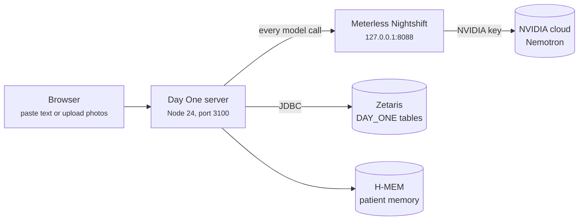

# Day One · handoff

Everything needed to get Day One running on your own laptop, what has been built so far, what broke along the way and how it was fixed, and how to carry on with the design in Figma.

**Where things stand (25 Oct):** the prototype works end to end. A patient pastes the text of a discharge summary (photos work once a vision model is switched on), six agents turn it into a checked, plain-language summary, and the patient can ask questions about it. All three sample cases pass the safety check live against Nightshift and Zetaris. The web page is an unstyled skeleton on purpose: the next job is designing it in Figma.

**Deadline:** 27 Oct, 23:45 UTC.

---

## Contents

1. [See it working in 2 minutes (no setup)](#1--see-it-working-in-2-minutes-no-setup)
2. [Full setup](#2--full-setup)
3. [How the app works](#3--how-the-app-works)
4. [Hackathon requirements: where we are](#4--hackathon-requirements-where-we-are)
5. [Problems we hit and how they were fixed](#5--problems-we-hit-and-how-they-were-fixed)
6. [Continuing with Figma](#6--continuing-with-figma)
7. [What's left](#7--whats-left)
8. [Rules that keep us safe and eligible](#8--rules-that-keep-us-safe-and-eligible)

---

## 1 · See it working in 2 minutes (no setup)

You only need [Node.js 24+](https://nodejs.org/). There's nothing to `npm install`.

```bash
git clone https://github.com/Day-Zero-Hackathon-Team/day-one.git
cd day-one
npm run sample
```

Open <http://localhost:3100>. Pick one of the three samples and press **Make it plain**.

Sample mode replays recorded Nightshift and Zetaris responses from `samples/`, so a run finishes in about a second and needs no keys, Nightshift or Zetaris. The H-MEM engine still runs for real. Recorded Q&A questions:

| Sample | Question that has a recorded answer |
| --- | --- |
| 1 · heart failure (shows the dose conflict) | *Can I drink alcohol?* |
| 2 · pneumonia | *When should I see my doctor again?* |
| 3 · knee replacement (no hospital record match) | *Can I take a bath?* |

Any other question in sample mode gets "Your papers don't say. Please ask your care team."

This is enough to design every screen. Live setup (below) is only needed to run new discharge summaries.

---

## 2 · Full setup

### What you need

| Need | Why | Check it with |
| --- | --- | --- |
| Node.js 24+ | Runs the server and agents (TypeScript, no build step) | `node --version` |
| Python 3 | Downloads the datasets (no `pip install`) | `python3 --version` (Windows: `py --version`) |
| Java 11+ | The Zetaris JDBC driver | `java -version` |
| Docker Desktop + the `zetaris-platform` folder from HackOS | The data layer | `./verify.sh` in that folder |
| Meterless Nightshift | The app's only AI provider | `npm run nightshift:check` |
| A free NVIDIA API key | The cloud models Nightshift routes to (Nemotron) | Nightshift's Providers tab |

### Step 1 · Zetaris and the data (once)

The full guide is [`data/README.md`](../data/README.md). Short version:

```bash
python3 data/download_datasets.py       # Windows: py data\download_datasets.py  (about 6 min)
```

Then in your unzipped `zetaris-platform` folder:

```bash
./preflight.sh
docker compose up -d
./verify.sh                             # every check should PASS
```

Back in `day-one`:

```bash
scripts/load_to_zetaris.sh
```

Tables land in the Lightning database `DAY_ONE` (always write `DAY_ONE.<table>`). The app finds `zetaris-platform` if it's next to `day-one`, in your home folder or in Downloads; otherwise set `ZETARIS_DIR` in `.env`. The login is read from that folder's own `.env`.

**On a Mac with 8 GB of RAM:** give Docker at least 6 GB (Docker Desktop → Settings → Resources → Memory → 7 GB) and turn on Rosetta (Settings → General), or `preflight.sh` fails. If Python downloads fail with `CERTIFICATE_VERIFY_FAILED`, double-click **Install Certificates.command** in `/Applications/Python 3.x/`.

### Step 2 · Install Nightshift

Nightshift is Meterless's local AI runtime. Our server talks to it like an OpenAI API at `http://127.0.0.1:8088/v1`, and it forwards each request to a cloud model using the provider keys you give it.

**Windows (what we used):**

1. Download `Nightshift_1.2.3_x64-setup.exe` from <https://meterless.ai/Nightshift/WIN/>. Ignore the other files in that folder (the `.msi`, older versions, and the generic `Nightshift-Setup-Windows*.exe`).
2. The build isn't code-signed, so check it before running it. The folder's `manifest.json` and `SHA256SUMS` give its SHA-256 (for 1.2.3: `0679114b9096c6a2c787cad893802ed8be75cee867fabb07ea42ceab6b78b008`):

   ```bash
   sha256sum ~/Downloads/Nightshift_1.2.3_x64-setup.exe
   ```

3. Run it. It installs for your user only (no admin prompt). SmartScreen will say it's unrecognised: **More info → Run anyway**.
4. Nightshift offers to download local models. We don't need them: every model we use is in the cloud. Skip them unless you want them.

**macOS:** we haven't tested the Mac build. Get it from the Meterless Nightshift downloads (<https://meterless.ai/Nightshift/>) or the Participant Setup Guide on HackOS. Our code already looks for the Mac token in `~/Library/Application Support/ai.meterless.runtime/proxy-token`.

### Step 3 · Get an NVIDIA API key and put it in Nightshift

The hackathon docs say where the key goes but not how to get one. You get it yourself, free:

1. Go to <https://build.nvidia.com> and sign in or sign up. This joins the free NVIDIA Developer Program, which includes trial access to the hosted models.
2. Open a Nemotron model page (for example *Llama 3.3 Nemotron Super 49B*) and click **Get API Key**. Copy it (it starts with `nvapi-`).
3. In Nightshift, open the **Providers** tab, add **NVIDIA**, and paste the key.

Before signing up, it's worth checking the NVIDIA folder in the HackOS Resource Center, the POWER workshop recording (19 Oct), or the *Help NVIDIA* channel: a hackathon key or credits would have higher limits than the free trial.

> 🔒 **The NVIDIA key goes in Nightshift's Providers tab and nowhere else:** not in the repo, not in `.env`, not in a chat, not on screen in the demo video. Our code never sees it. It only needs Nightshift's own token, which it reads by itself (see step 5).

### Step 4 · Switch off the NVIDIA models your key can't use

**Do this or every run takes several minutes longer.** Nightshift's router tries the Nemotron models it lists. On a free key, some of them answer *"Function … Not found for account"*, and each failure costs about 2 minutes before our client retries.

In Nightshift, open **Compute sources** and switch off the ones that fail. On our key these were:

- Nemotron Super 49B v1.5
- Nemotron 3 Super 120B
- Llama 3.1 Nemotron Ultra 253B

Your key may differ. If runs are slow, look in `runs/<job>/trace.jsonl` for `Not found for account` and switch off the model it names. (Or enable that model for your account on build.nvidia.com.) What worked for us was **Nemotron 3 Ultra 550B**, which is what answers our text agents.

### Step 5 · Configure and check

```bash
cp .env.example .env
npm run nightshift:check
```

`nightshift:check` is a live test (7 checks): Nightshift is found, a wrong token is refused, a real Nemotron answer comes back with its reasoning stripped, the model and signed receipt are named, nothing leaks between calls, and a trace line is written.

On the machine running Nightshift you don't set a token: the client reads it from Nightshift's folder (`%LOCALAPPDATA%\ai.meterless.runtime\proxy-token` on Windows, `~/Library/Application Support/ai.meterless.runtime/proxy-token` on macOS). Anywhere else, set `METERLESS_RUNTIME_TOKEN` in `.env`.

The other settings in `.env.example`:

| Variable | Default | What it does |
| --- | --- | --- |
| `METERLESS_BASE_URL` | `http://127.0.0.1:8088/v1` | Where Nightshift is. Any pasted form is normalised. |
| `METERLESS_APP_ID` | `day-one` | The app name Nightshift sees (each app gets its own routing mode). |
| `SAMPLE_MODE` | `false` | `true` replays `samples/` with no network. |
| `NIGHTSHIFT_RECORD`, `ZETARIS_RECORD` | `false` | `true` saves live responses into `samples/` (to re-record after changing a prompt). |
| `ZETARIS_DIR` | found automatically | Your `zetaris-platform` folder. |
| `VISION_ROUTE` | `meterless/vision` | Route the Scan agent uses for photos. |
| `SAFETY_ROUTE` | `meterless/text` | Route the Safety checker uses (`meterless/judge` 404'd on our setup). |
| `READING_GRADE_MAX` | `8` | Highest reading grade a section may have (target is 6). |
| `PORT` | `3100` | Web server port. |

### Step 6 · Run it

```bash
npm start
```

Open <http://localhost:3100>. A live run takes 3 to 6 minutes once the failing models are switched off. Every agent's input and output, the agent conversation, and one trace line per model call (with the model that answered and Nightshift's signed receipt id) are saved in `runs/<job>/`. You can reopen any job with `http://localhost:3100/?job=<id>`, even after a restart.

### Tests

```bash
npm test                  # 18 unit tests, offline (Nightshift client, H-MEM feature, safety rules)
npm run test:hmem         # H-MEM engine conformance suite: 13/13
npm run nightshift:check  # live check against a running Nightshift: 7/7
```

---

## 3 · How the app works



The server, Nightshift and Zetaris all run on the same machine. Nightshift only listens on `127.0.0.1`. For a public demo link, tunnel **our web server only** (port 3100), never Nightshift's port.

### The agents

| Agent | Does | Code |
| --- | --- | --- |
| Scan | Numbers every line (`p1:L4`) so everything later can cite it. Reads photos through a vision model. | `src/agents/scan.ts` |
| Extract | Pulls out diagnoses, medicines, follow-ups, warning signs, each tied to its line. | `src/agents/extract.ts` |
| Lookup | Looks up each medicine and term in Zetaris, finds the patient's hospital record (name + date of birth) and their medicine list. Zetaris queries are fixed code; the model only plans and interprets. | `src/agents/lookup.ts`, `src/zetaris.ts` |
| Patient memory (H-MEM) | Stores every dose with its source, and flags a conflict when the papers and the hospital record disagree on a dose without the papers saying it changed. | `src/memory.ts`, `engines/hmem/` |
| Simplify | Writes the grade-6 summary, schedule, "when to get help" list and questions. Every bullet cites its sources. | `src/agents/simplify.ts` |
| Safety checker | Code checks (sources exist, doses match their line, every medicine and warning is covered, conflicts are flagged, reading grade) plus a separate model check. | `src/agents/safety.ts` |
| Q&A | Answers follow-up questions from H-MEM recall and the papers only. No line cited, no answer. | `src/agents/qa.ts` |
| Read-aloud | Browser speech with word highlighting. | `public/app.js` |

### How they pass work between each other

The hackathon wants a pipeline that isn't one-directional. The orchestrator (`src/pipeline.ts`) is plain code that routes work back and forth:

- **Extract → Scan:** lines Extract can't read with confidence in a photo are sent back to be re-read.
- **Lookup → Extract → Lookup:** a medicine Zetaris doesn't know goes back to Extract to re-check the line, and Lookup tries again as a brand name. (This is how "Tylenol" resolves to acetaminophen.)
- **H-MEM → Safety checker:** an unexplained dose conflict is escalated, and the summary must tell the patient to check that dose with their care team. Sample 1 shows this: the papers say carvedilol 12.5 mg, the hospital record says 25 mg.
- **Safety checker → Simplify:** problems go back for revision, at most twice.
- **Safety checker → Extract:** a dose that isn't on its own source line means Extract misread it. Extract re-reads, the record is re-grounded, Simplify rewrites.
- **Fallback:** a section that still fails shows the original text with "Ask your care team".

Every message is posted to the job's shared board and shown live on the progress screen as the agent conversation.

### Code map

| Path | What |
| --- | --- |
| `src/server.ts` | Web server and API (`POST /api/jobs`, `GET /api/jobs/:id`, `POST /api/jobs/:id/ask`, `GET /api/status`, `GET /api/samples`) |
| `src/pipeline.ts` | Orchestrator and feedback loops |
| `src/agents/` | The agents |
| `src/nightshift.ts` | Nightshift client: headers, retries, trace, record/replay |
| `src/memory.ts` | Patient medicine memory on H-MEM |
| `src/zetaris.ts`, `scripts/ZetarisJson.java` | Fixed Zetaris lookups over JDBC |
| `src/types.ts` | Every data shape the page uses |
| `public/` | The web page: `index.html`, `styles.css`, `app.js` |
| `engines/hmem/` | Meterless H-MEM engine, vendored (Apache 2.0) |
| `samples/inputs/` | Three sample discharge summaries for real synthetic patients in Zetaris |
| `samples/nightshift/`, `samples/zetaris/` | Recorded responses for sample mode |
| `docs/features.md` | Every screen and element, for design |
| `docs/meterless-integration.md` | Meterless details: routes, vision options, scopes |

---

## 4 · Hackathon requirements: where we are

| Requirement | How we meet it | Status |
| --- | --- | --- |
| Nightshift is the primary AI provider | Every model call goes through `src/nightshift.ts`. No direct vendor calls. | ✅ |
| At least one Meterless engine in a working feature, with a passing test | H-MEM powers patient medicine memory (dose conflicts, sources, audit ledger, Q&A recall). | ✅ 13/13 conformance + 4 feature tests |
| NVIDIA through Nightshift, showing which model handled each request | Text agents are answered by Nemotron 3 Ultra. Every call's trace line and the page's "How we made this" panel name the model and receipt. | ✅ |
| Agents work together, not a one-way line | Five feedback loops, shown live on the page | ✅ |
| Live enterprise data | Zetaris: openFDA drug labels, a medical terms table, Synthea hospital records | ✅ |
| `SAMPLE_MODE=true` runs with no credentials | `npm run sample` | ✅ |
| README and `metadata.json` say which engines are used | README done; `metadata.json` not written yet | ⏳ |
| Demo video | Not made yet | ⏳ |

---

## 5 · Problems we hit and how they were fixed

Worth knowing in case they come back.

| Problem | Cause | Fix |
| --- | --- | --- |
| Runs took 10+ minutes; calls failed after ~136 s with *"Function … Not found for account"* | Nightshift routes to NVIDIA models the free key can't use | Switch them off in Compute sources (step 4). The client also retries this error. |
| Simplify returned `{"steps": [...]}` instead of a summary | Nightshift split the call into tiers and returned only its planning step | Every call sends `meterless-tier-split: off` |
| Answers started with the model's reasoning | Nemotron writes its thinking before `</think>` | The client keeps only the text after the last `</think>` |
| `meterless/judge` returned 404 | With only the NVIDIA provider, that route points at an endpoint the key can't use | The checker uses `meterless/text` with its own scope (`SAFETY_ROUTE`) |
| Nightshift's own memory leaked earlier answers into new calls | Nightshift remembers and caches by scope | Every call gets its own `meterless-scope` (`day-one.<job>.<agent>.<random>`) |
| A specific model can't be chosen | Nightshift binds each app to a routing mode and ignores the model id | By design. The receipt still names the model. |
| "Metformin ER", "Tylenol", "docusate" not found in Zetaris | Release-form suffixes and brand names | `baseDrugName` strips ER/XR/doses; Lookup retries as a brand; near-match fallback |
| A failed revision or checker call killed the whole job | Empty or cut-off model answers | Retry once, keep the previous draft, mark the model check as skipped; the job always finishes |
| Q&A answers wrapped in `{"final": {...}}` or cut off | Model formatting | Unwrap, retry once, otherwise "ask your care team" |
| Photos: no model reads images | `meterless/vision` has no provider on our setup | Photo uploads fail fast with "paste the text instead". Options in section 7. |

---

## 6 · Continuing with Figma

### What to design

[`docs/features.md`](features.md) is the design brief. It lists every screen, every element, what it does, every state to design, and the exact data behind each element. The screens:

1. **Add your discharge summary:** photo/text tabs, photo picker with page thumbnails, text box, sample picker, *Make it plain*, errors including "please rescan page N".
2. **Working on it:** the step list (steps can run more than once, e.g. "revision 1") and the live **agent conversation**. This is our "agents work together" story for the judges, so make it readable.
3. **Your summary:** safety banner, read-aloud, sections with a **"Where does this come from?"** toggle on every bullet, fallback cards, *When to get help*, medicine schedule, comparison with the hospital record (including the red *Check with care team* tag), questions for the doctor, Q&A, and the *How we made this* evidence panel.

Plus the states: Nightshift offline, Zetaris offline, photo reading off, rescan needed, no hospital record matched, open dose conflict, partial safety pass, long run. It needs to work on a phone: patients will photograph their papers.

### Getting real content to design with

- Run `npm run sample` and use sample 1 (heart failure): it has the dose conflict, a full schedule, the comparison table and a recorded Q&A answer. Sample 3 shows "no hospital record matched".
- Every finished job's full data is at `http://localhost:3100/api/jobs/<id>` (and saved in `runs/<id>/job.json`). Copy real strings from there instead of lorem ipsum: bullet lengths and medicine names matter for the layout.
- The data shapes are in `src/types.ts`. Designs can rearrange anything, but they can only show what's in that data, unless we add it.

### Turning the design into the page

The design only touches `public/`. The server and agents don't change.

- `public/index.html` is the markup. `public/app.js` finds elements by these ids, so keep them (or update `app.js` to match): `status`, `input-view`, `tab-photo`, `tab-text`, `panel-photo`, `drop`, `files`, `thumbs`, `vision-note`, `panel-text`, `text`, `sample`, `go`, `input-error`, `progress-view`, `steps`, `messages`, `result-view`, `banner`, `speak`, `stop`, `again`, `summary`, `call911`, `schedule`, `questions`, `qa`, `qa-form`, `qa-input`, `qa-ask`, `qa-list`, `evidence`, `final-messages`.
- `public/styles.css` is almost empty on purpose. Replace it with the design's styles.
- `app.js` builds the result sections in code (search for `render`). Change its markup there for things like bullet cards and table rows.
- No build step: edit, reload the browser. Keep it dependency-free (no frameworks) unless we agree otherwise; it keeps setup to "install Node".
- If you use Claude Code with the Figma Dev Mode MCP server, point it at a frame and at `docs/features.md`, and ask it to restyle `public/` keeping the ids above.

---

## 7 · What's left

In rough priority order:

1. **Design and restyle the page** (section 6).
2. **`metadata.json`** naming Meterless Nightshift, the H-MEM engine and NVIDIA Nemotron, as the submission requirements ask.
3. **Demo video:** paste sample 1 → watch the agent conversation → the summary flags the carvedilol dose → open "Where does this come from?" → the evidence panel naming Nemotron with a receipt → ask a question.
4. **Photos (optional but in the pitch).** Pick one way to give Nightshift a vision model (details in `docs/meterless-integration.md`):
   - A · turn on Nemotron 3.5 Super VL in Nightshift (opt-in `NVIDIA_SUPER_VL`; Meterless flagged it as unreliable)
   - B · turn on NVIDIA partner models (opt-in `NVIDIA_PARTNER_ROWS`, experimental)
   - C · add a Google Gemini key in Nightshift's Providers tab (free tier, reliable; text agents stay on Nemotron)
   - D · add an OpenRouter key (free vision models, rate-limited)

   The text box stays as the fallback either way.
5. **Q&A safety:** answers must cite a line but skip the full safety checker, and two answers added small details the papers don't state. Running answers through the checker's code rules would close that.
6. **Read-aloud through Nightshift** (`meterless/speech`, not tried yet) instead of the browser voice.
7. **Re-record samples** if any prompt changes: set `NIGHTSHIFT_RECORD=true` and `ZETARIS_RECORD=true`, delete `samples/nightshift/` and `samples/zetaris/`, run the three samples and the three Q&A questions live.

---

## 8 · Rules that keep us safe and eligible

- **Never commit secrets.** `.env`, `runs/` and `data/memory/` are git-ignored. The NVIDIA key lives only in Nightshift. The Zetaris password is read from the Zetaris folder, not from our repo.
- **Never expose Nightshift's port (8088) publicly.** Its token gives full use of the NVIDIA key behind it. Tunnel only port 3100.
- **Every model call goes through Nightshift.** No direct OpenAI, NVIDIA or Google calls in our code.
- **Nothing reaches the patient without a source, and medicine conflicts are never auto-resolved.** These are the two safety rules the pitch rests on. Don't loosen the checks in `src/agents/safety.ts` to make a run pass.
- **Synthetic data only.** The hospital records are Synthea patients; never paste a real patient's papers into a demo.
