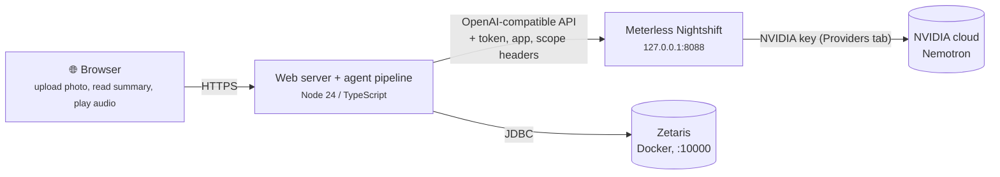

# Meterless integration plan

How day-one meets the Meterless requirements, and why each piece earns its place in a discharge-summary web app rather than being bolted on.

**The app:** a patient opens a website and uploads a photo of their discharge summary. The backend runs the agent pipeline and returns a plain-language summary. All models are cloud models, reached through Meterless Nightshift.

## What the rules require

From the hackathon overview and submission requirements:

| # | Requirement | Our answer | Status |
| --- | --- | --- | --- |
| 1 | **Meterless Nightshift is the primary AI provider** | Every agent calls Nightshift through `src/nightshift.ts`. No direct vendor calls. | ✅ Client built and checked live |
| 2 | **At least one Meterless Engine in a working feature, with a passing test** | **H-MEM** powers *Patient medicine memory* (Part 3, `src/memory.ts`). | ✅ Conformance 13/13, feature tests 4/4, caught the carvedilol conflict in a live run |
| 3 | **NVIDIA wherever it contributes** (DGX Spark award: a Nemotron model through Nightshift, showing which model handled the request) | Nightshift routes our text agents to Nemotron. Every call's trace line names the model and its signed receipt. | ✅ Nemotron 3 Ultra answering, logged |
| 4 | Logs that show which model handled each request | `runs/<job>/trace.jsonl`, one line per call. | ✅ |
| 5 | `SAMPLE_MODE=true` runs without Zetaris, Nightshift or credentials | Recorded responses replay from `samples/nightshift/`. | ✅ Three samples recorded (`npm run sample`) |
| 6 | Say which engines are used, and where, in the README and `metadata.json` | README done | ⏳ `metadata.json` |

---

## Part 1 · Architecture



**Nightshift and Zetaris both run on one machine, so the web server must run there too.** Nightshift only listens on `127.0.0.1`, and Zetaris is a local Docker stack. The browser can be anywhere:

- **Demo and development:** run the server on the Nightshift machine and open `http://localhost:<port>`.
- **A public link for judges or the demo video:** put a tunnel (for example Cloudflare Tunnel) in front of **our web server only**. Never expose Nightshift's port: its token gives full access to the NVIDIA key behind it.
- **Judges running the repo themselves:** `SAMPLE_MODE=true` needs no Nightshift, Zetaris or keys.

---

## Part 2 · Nightshift as the AI provider

### Setup (the machine that runs the server)

1. Install Nightshift for Windows: `Nightshift_1.2.3_x64-setup.exe` from <https://meterless.ai/Nightshift/WIN/>. Its SHA-256 is in `SHA256SUMS` in the same folder. The build isn't code-signed, so SmartScreen warns.
2. Get an NVIDIA API key at <https://build.nvidia.com> (sign in → open a model → **Get API Key**) and add it in Nightshift's **Providers** tab. It never goes in our repo or `.env`.
3. **Switch off NVIDIA models your key can't use.** Nightshift's router tries every Nemotron model it lists. On a free key some of them fail with *"Function … Not found for account"*, and each failure costs about 2 minutes. In Nightshift, open **Compute sources** and switch those models off (on the dev machine: Nemotron Super 49B v1.5, Nemotron 3 Super 120B, Llama 3.1 Nemotron Ultra 253B). Or enable them for your account on build.nvidia.com. Our client retries this error and falls back gracefully, but runs are much faster without it.
4. Check the setup: `npm run nightshift:check` (see *Tests*). On this machine the client reads the token from `%LOCALAPPDATA%\ai.meterless.runtime\proxy-token` by itself. Anywhere else, set `METERLESS_RUNTIME_TOKEN`.

### What the client does (`src/nightshift.ts`)

| Rule | How |
| --- | --- |
| Provider contract | `Authorization: Bearer <token>`, `meterless-app: day-one`, 180 s timeout, any pasted URL normalised to `<host>/v1`. |
| Status | `GET /v1/models`: 401/403 → *unauthorized*, 200 with `meterless/*` ids → *online*, anything else → *offline*. An empty **Ollama on port 11434** counts as offline. `autoDetect()` tries ports 8088, 8090, 8787 and 11434. |
| **Isolation** | Each call sends its own `meterless-scope: day-one.<job>.<agent>.<random>`. Nightshift fences its built-in memory **and** its answer cache by scope, so nothing from another patient, or from another agent's draft, is injected. Measured: with the default scope a repeated question got Nightshift memory injected; with per-call scopes it got none. |
| Clean answers | Nemotron returns its reasoning followed by `</think>`. The client keeps only the text after the last `</think>`. Every call sends `meterless-tier-split: off`, so Nightshift answers in one step instead of returning only its planning tier. |
| Retries | Up to 3 attempts, for network errors, 5xx and NVIDIA's *"Not found for account"*. A wrong token fails at once. |
| Evidence | One trace line per call: agent, attempt, route, **routed model**, **receipt id** (Nightshift signs every receipt), phases, cache status, memory injected, latency and tokens. |
| Sample mode | `NIGHTSHIFT_RECORD=true` saves each live response, keyed by agent and request hash. `SAMPLE_MODE=true` replays them with no network. |

### Routes for each agent

Nightshift chooses the model; we choose the routing mode. **A specific model can't be pinned:** Nightshift binds each external app to a mode the first time it calls and, by design, records but doesn't obey a model id in the request. The receipt always says which model answered.

| Agent | Route | Notes |
| --- | --- | --- |
| 01 Scan | `meterless/vision` (`VISION_ROUTE`) | ⚠️ **Not available yet.** See *Vision*. |
| 02 Extract | `meterless/text` | JSON output (`json: true`). |
| 03 Lookup | `meterless/text` | Zetaris lookups are plain code; the model only interprets. |
| 04 Simplify | `meterless/text` | |
| 05 Safety checker | `meterless/text` (`SAFETY_ROUTE`) | A separate call with its own scope, so it never sees Simplify's reasoning or memory, only the bullets and sources we pass it. `meterless/judge` was tried: with only the NVIDIA provider, Nightshift sent it to an endpoint the account can't use (404). |
| 06 Read-aloud | `meterless/speech` | Listed as available. Not yet tried; the page uses the browser voice. |
| + Q&A | `meterless/text` | Answers from H-MEM recall and the papers; no cited line, no answer. |

Every text route currently answers with **Nemotron 3 Ultra 550B** (the only provider configured is NVIDIA), which also qualifies us for the NVIDIA award. To give the checker a different routing profile, call it with `METERLESS_APP_ID=day-one-checker` and set that app's mode (for example *deep*) in Nightshift's **Apps** panel. It is still Nemotron, routed separately.

### Vision: the open decision

Nightshift has no cloud route that reads images with the current setup (`meterless/vision`: *"no lane … and no configured provider serves it"*). The options:

| Option | Account needed | Reliability | NVIDIA story |
| --- | --- | --- | --- |
| **A. Turn on Nemotron 3.5 Super VL** (Nightshift opt-in `NVIDIA_SUPER_VL`) | None (your NVIDIA key) | ⚠️ Meterless switched it off after 94 failed hosted calls (empty, aborted and 500 responses) | Best: Nemotron reads the scan |
| **B. Turn on NVIDIA partner models** (opt-in `NVIDIA_PARTNER_ROWS`, e.g. GLM 5.3 Flash, which can read images) | None | Marked experimental | Good: still on the NVIDIA key |
| **C. Add a Google Gemini key** in Nightshift's Providers tab (Gemini Flash reads images) | Google AI Studio (free tier) | Good | Scan is on Gemini; every text agent stays on Nemotron |
| **D. Add an OpenRouter key** (free vision models listed, e.g. Gemma 4) | OpenRouter | Free tiers are rate-limited | Same as C |

Both opt-ins are switches inside the Nightshift app, not files we edit. Whichever we pick, keep a fallback that lets the patient type or paste the text, so the demo never depends on one endpoint.

---

## Part 3 · The engine: H-MEM → *Patient medicine memory*

[H-MEM](https://github.com/Meterless/Meterless/tree/main/engines/hmem) is a memory store with provenance, conflict handling and an audit ledger built in. Those are also our two safety rules. This is **our own** H-MEM, separate from the one inside Nightshift (which we keep out of our calls with per-call scopes).

| H-MEM property (from its `AGENTS.md`) | What it gives our app |
| --- | --- |
| A record **with no `source` is rejected by construction** | *"Nothing reaches the patient without a source"* is enforced by the store. Every memory carries `p2:L1` or `drug:furosemide`. |
| **Conflict detection**, including *high-similarity claims with divergent numeric values* | "furosemide 40 mg BID" (discharge paper) against "furosemide 20 mg daily" (Zetaris hospital record) becomes a conflict record, shown as *"Check this dose with your care team"*. |
| **Append-only trust ledger** | Powers *"Where does this come from?"* and the audit trail. |
| **Retrieval with reinjection**, answers citing memory ids | The Q&A stretch goal answers only from this patient's memories, with citations. |

**The feature:**
1. Extract writes each field with its source.
2. Lookup writes the Zetaris hospital-record rows.
3. H-MEM's conflict scan becomes `hospital_record_diff`.
4. Simplify and the Safety checker read from memory instead of whole documents.
5. The web page shows the ledger trace for each bullet.

> 🔒 **Domain override:** H-MEM treats `user_correction` as highly reliable and auto-resolves conflicts at ≥ 0.70 confidence. **We never auto-resolve a medication or dose conflict.** It stays `open` for the care team. Queueing for review is always allowed by the spec.

**Getting it in, and the passing test:**

```bash
npx degit meterless/meterless/engines/hmem engines/hmem   # keep its LICENSE (Apache 2.0)
cd engines/hmem/reference && npm install && npm test
npx tsx ../conformance/runner.ts                            # exit 0 = pass
```

Then our feature test: a discharge summary plus a hospital record with a different furosemide dose must produce an open conflict, and the Simplify output must fall back to *"Ask your care team"*.

---

## Tests

| Command | What it proves | Result (25 Oct) |
| --- | --- | --- |
| `npm test` | Client unit tests, offline: URL normalising, think-stripping, status rules (incl. Ollama), headers (incl. tier split off), a per-call scope, bounded retries, no retry on a wrong token, sample record and replay | 7/7 pass |
| `npm run nightshift:check` | Live, against Nightshift: Auto Detect, wrong token → *unauthorized*, a real Nemotron answer with reasoning stripped, model and receipt named, no memory carried between calls, trace written | 7/7 pass |
| `npm run test:hmem` | H-MEM conformance suite on the vendored engine | 13/13 pass |
| `npm test` (memory, safety) | H-MEM feature: unexplained dose difference opens a conflict, a stated change doesn't, different drugs never conflict, sources are mandatory. Safety checker code rules. | 11/11 pass (18 in all) |
| Live runs | The three samples in `samples/inputs/`, end to end against Nightshift and Zetaris | 3/3 pass the safety check; sample 1's carvedilol conflict is flagged |

---

## Configuration

All settings are in `.env.example`, with what each does in [`HANDOFF.md`](HANDOFF.md#step-5--configure-and-check). The NVIDIA key is not among them. It lives only in Nightshift.

---

## Still open

1. **Vision**: pick option A, B, C or D.
2. Three NVIDIA models fail on this key with "Function … Not found for account" (Nemotron Super 49B, Super 120B, Ultra 253B). Nightshift's router keeps trying them; each failure costs about 2 minutes before the client retries. Enable them on build.nvidia.com or turn them off in Nightshift.
3. The installed Nightshift is 1.2.2, whose checksum is no longer in the published `SHA256SUMS`. 1.2.3 has a published hash.
4. `meterless/speech` for Read-aloud hasn't been tried.

## Sources

- Meterless repo: <https://github.com/Meterless/Meterless> (`engines/`, `docs/agent-ready/add-meterless-provider.md`, `docs/products/nightshift/`).
- Nightshift 1.2.2 as installed: `engine/IPC_SPEC.md` (app mode binding), `engine/js/engine/orchestrator.js`, `hmem.js` and `cache.js` (scope walls), and `models.js` (vision rows and their gates).
- Engines and template prompts: <https://meterless.ai/engines.html>
- Hackathon overview, submission requirements and the APPROACH guide (HackOS resources).

For setup on a new machine and what's left to do, see [`HANDOFF.md`](HANDOFF.md).
