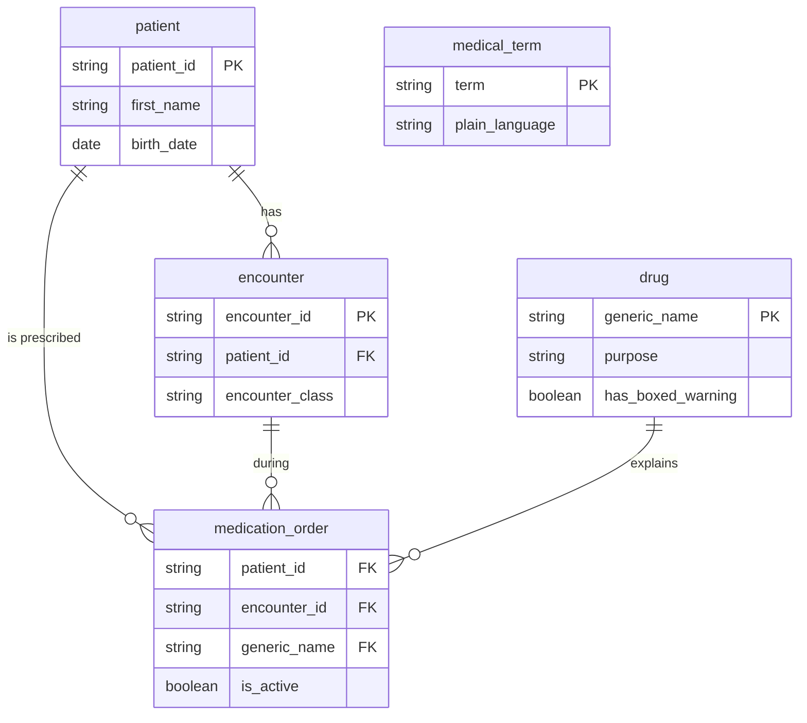

# Day One × Zetaris: Unified Semantic Layer

How Day One meets the **Build with Zetaris** evaluation criteria. Every query here has been run against a live Zetaris instance; its output is saved in [`results/`](results/).

```bash
scripts/load_to_zetaris.sh     # once: load the three datasets (see data/README.md)
npm run zetaris:usl            # build the USL, run every query and DQ rule, refresh results/
npm run zetaris:usl -- 6 7     # just the files starting with 6 and 7
```

## Criteria → evidence

| Criterion | Minimum | Where | Status |
| --- | --- | --- | --- |
| **1a** Use case and data sources | 3+ data sources | [`docs/1a-use-case-and-sources.md`](docs/1a-use-case-and-sources.md) | ✅ openFDA drug labels, medical terms glossary, Synthea hospital records |
| **1b** Onboard sources, verify, exploratory queries | 2-3 queries per source | [`sql/1_…`](sql/1_explore_drug_reference.sql) · [`2_…`](sql/2_explore_medical_terms.sql) · [`3_…`](sql/3_explore_hospital_records.sql) → [`results/1-3`](results/) · loader verifies row counts: [`scripts/load_to_zetaris.sh`](../scripts/load_to_zetaris.sh) | ✅ 4 + 3 + 4 queries |
| **1c** USL + its DDL | 1 USL and its DDL | [`sql/4_usl_ddl.sql`](sql/4_usl_ddl.sql) (DDL) · [`sql/5_usl_activate.sql`](sql/5_usl_activate.sql) (bindings) | ✅ `discharge_care`, 5 tables, 8 constraints |
| | 2-3 queries showing the USL is active | [`sql/6_usl_queries.sql`](sql/6_usl_queries.sql) → [`results/6_usl_queries.md`](results/6_usl_queries.md) | ✅ 4 queries; all 5 tables report `activated = true` |
| | 1 data quality rule shown to execute | [`sql/7_data_quality.sql`](sql/7_data_quality.sql) → [`results/7_data_quality.md`](results/7_data_quality.md) | ✅ 4 business rules + 6 constraint checks executed, 2 real defects found |
| **2a** How the USL saved time vs. hand-coding | Document · *bonus: hand-coded part + comparison* | [`docs/2a-time-saved.md`](docs/2a-time-saved.md) · [`handcoded/compare.ts`](handcoded/compare.ts) | ✅ incl. bonus: identical results both ways |
| **2b** How the USL would / wouldn't help our work | Document · *bonus: project + time forecast* | [`docs/2b-usl-in-our-work.md`](docs/2b-usl-in-our-work.md) | ✅ incl. bonus: 5-hospital rollout, ~58% saving forecast |
| **2c** Make the USL stronger | PM requirement · *bonus: mock feature + resulting USL* | [`docs/2c-make-the-usl-stronger.md`](docs/2c-make-the-usl-stronger.md) · [`sql/8_…`](sql/8_mock_concept_resolution.sql) · [`9_…`](sql/9_mock_concept_activate.sql) → [`results/9_…`](results/9_mock_concept_activate.md) | ✅ incl. bonus: runnable mock, 874 → 692 unlabeled orders |

## 1c · The USL

`lightning.metastore.day_one.discharge_care` is one business model over the three sources:



| USL table | Physical source | What the activation query adds |
| --- | --- | --- |
| `patient` | `DAY_ONE.hospital_records_patients` (Synthea) | Business column names; strips the digits Synthea appends to names |
| `encounter` | `DAY_ONE.hospital_records_encounters` (Synthea) | Business column names |
| `medication_order` | `DAY_ONE.hospital_records_medications` (Synthea) **+** `DAY_ONE.drug_reference` (openFDA) | Resolves each hospital medicine to its openFDA generic name (cross-source); `is_active` |
| `drug` | `DAY_ONE.drug_reference` (openFDA) | `has_boxed_warning` boolean; `generic_name` as the key |
| `medical_term` | `DAY_ONE.medical_terms` (glossary) | Normalises terms to upper case so duplicates surface |

### Data quality results (live)

| Rule | Kind | Table | Total | Valid | Invalid |
| --- | --- | --- | --- | --- | --- |
| `drug_explains_purpose` | business | drug | 204 | 204 | 0 |
| `term_has_plain_language` | business | medical_term | 197 | 197 | 0 |
| `stop_not_before_start` | business | medication_order | 3,216 | 3,216 | 0 |
| `has_drug_label` | business | medication_order | 3,216 | 2,342 | **874** |
| `patient_id` | primary key | patient | 111 | 111 | 0 |
| `patient_id` | foreign key | encounter | 5,059 | 5,059 | 0 |
| `generic_name` | primary key | drug | 204 | 204 | 0 |
| `generic_name` | foreign key (cross-source) | medication_order | 3,216 | 2,342 | **874** |
| `term` | primary key | medical_term | 197 | 197 | 0 (was 198 · 196 · **2** before the fix below) |

**What the rules found:**
- **The glossary defined CAP twice** (fixed): `cap` = *capsule* and `CAP` = *community-acquired pneumonia*. The app looks terms up case-insensitively, so the pneumonia patient's lookup returned both, and the AI was left to guess which applied. We merged them into one row that gives the pneumonia meaning first and the capsule meaning for doses, reloaded Zetaris, and re-recorded the samples. `src/glossary.test.ts` now fails on any case-insensitive duplicate.
- **27% of hospital medication orders have no drug label.** Some are naming mismatches ("Alendronic acid" vs. openFDA's "alendronate"); the rest are medicines missing from the reference set. That finding drives the [2c](docs/2c-make-the-usl-stronger.md) requirement.
- **Brand names barely resolve** (exploratory query 1·Q3): for 172 of 204 drugs the openFDA "brand name" is just the generic name again, so a paper saying "Lasix" or "Eliquis" matches nothing. That's another reason for curated synonyms.

## Files

| Path | What |
| --- | --- |
| `sql/` | Every statement, in run order. Statements end with `;` at a line end; `COMPILE USL` takes the rest of its file. `-- @ignore-error` marks cleanup that may fail on a first run. |
| `results/` | Generated by `npm run zetaris:usl`: each statement and its live result |
| `handcoded/compare.ts` | The same checks hand-coded over the raw CSVs (2a bonus) |
| `docs/` | 1a, 2a, 2b, 2c write-ups |
| `../scripts/zetaris_usl.ts` | The runner |
